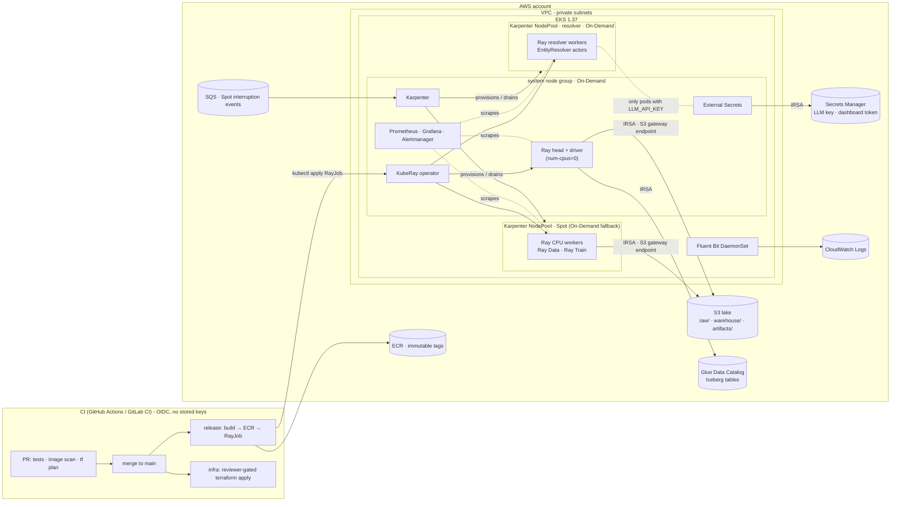

# Ray AI Platform on EKS: Corporate Registry Pipeline

A "paved road" for scheduled Ray pipelines on Kubernetes. The scheduled job:
1. Ingests two corporate datasets with Ray Data.
2. Resolves records that belong to the same company, using an `EntityResolver` actor pinned to its own node group.
3. Upserts the harmonized registry into an Apache Iceberg table in one transactional commit.
4. Trains a distributed XGBoost model with Ray Train to predict annual revenue.

> **Status:** the pipeline runs end to end locally, both in a container and as a `RayJob` through KubeRay under restricted Pod Security. The AWS Terraform validates, passes the IaC scan, and was rehearsed against an AWS API emulator, but it has **not been applied to a real AWS account**. IRSA, Karpenter Spot behaviour and CI against a live cluster still need a sandbox. Details: [What is verified](#what-is-verified-and-what-is-not).

---

## Where each requirement lives

| Requirement | Files |
|---|---|
| Terraform layers: EKS, S3, KubeRay, node pools, Spot | [`infra/`](infra/README.md), [`karpenter.yaml`](infra/50-platform/charts/platform-baseline/templates/karpenter.yaml) |
| Ray Data / Ray Train cluster config | [`rayjob.yaml`](k8s/pipeline/rayjob.yaml), [below](#ray-data-and-ray-train-configuration) |
| EntityResolver on its own node group | [`rayjob.yaml`](k8s/pipeline/rayjob.yaml), [`ray_pipeline.py`](app/ray_pipeline.py), [`test_scheduling.py`](tests/test_scheduling.py) |
| IRSA and secrets | [`40-identity`](infra/40-identity/main.tf), [`ray-namespace.yaml`](infra/50-platform/charts/platform-baseline/templates/ray-namespace.yaml) |
| Iceberg catalog and transactional upsert | [`30-data`](infra/30-data/main.tf), [`iceberg_sink.py`](app/corpreg/iceberg_sink.py) |
| CI/CD: plan on PR, build + RayJob on merge | [`.github/workflows`](.github/workflows), [`.gitlab-ci.yml`](.gitlab-ci.yml), [`scripts/ci`](scripts/ci) |
| Metrics, dashboard access, logs | [`observability.yaml`](infra/50-platform/charts/platform-baseline/templates/observability.yaml), [`50-platform`](infra/50-platform/main.tf), [`dashboard.sh`](scripts/dashboard.sh) |

Design choices and the alternatives I considered are in [docs/decisions.md](docs/decisions.md). Failure handling is in [docs/runbook.md](docs/runbook.md).

---

## Architecture



**Pipeline flow** ([`app/ray_pipeline.py`](app/ray_pipeline.py)):

```
read 2 CSVs (Ray Data, parallel) → standardize → groupby(country) → EntityResolver actor pool [resolver nodes]
  → quality gate (row counts, resolution precision) → Iceberg upsert (1 atomic commit)
  → Ray Train XGBoost (Spot workers, checkpoint every 25 rounds to S3) → model gate (R²)
  → predict revenue for companies without a reported value → Iceberg (overwrite by run_id)
```

### Repository map

| Path | Purpose |
|---|---|
| `datasets/` | The two source CSVs (1,200 rows each) + ground truth, with a [data dictionary](datasets/README.md) |
| `app/` | Pipeline (`ray_pipeline.py`), package `corpreg/` (datagen, resolution, Iceberg sink, training), Dockerfile |
| `infra/00-bootstrap … 50-platform` | Six Terraform layers, each with its own state ([why](docs/decisions.md#d1-terraform-split-into-six-layers-each-with-its-own-state-wired-through-ssm)) |
| `infra/50-platform/charts/platform-baseline` | Karpenter NodePools, `ray` namespace guardrails (RBAC, secrets, NetworkPolicy, quota), monitors, alerts, dashboard |
| `k8s/pipeline/rayjob.yaml` + `k8s/render.py` | One RayJob spec, rendered per environment (`aws`/`local`) and kind (`RayJob`/`RayCronJob`) |
| `k8s/local/` | Local stand-ins: SeaweedFS (S3 API) + Apache Iceberg REST catalog |
| `scripts/ci/` | All CI logic. GitHub and GitLab only call these |
| `tests/` | Unit, Ray multi-node scheduling, Iceberg idempotency, manifest-policy tests |

---

## Quick start

### 1. Verify on a laptop in 2 minutes (Docker only)

```bash
make demo
```

This runs the complete pipeline twice in the production image: real Ray (Ray Data, actor pool, Ray Train) and a real Iceberg catalog (SQL catalog on local files). Expected output:

```
== demo-1
  status=SUCCEEDED  duration=~30s  sources={'supply_chain': 1200, 'financial': 1200}
  entity resolution: 1504 golden records, precision=0.9834 recall=0.9916
  iceberg upsert: inserted=1504 updated=0 snapshots_total=1
  model: r2(log revenue)=~0.94 median APE=~0.18
  predictions published: 491
== demo-2
  iceberg upsert: inserted=0 updated=0 snapshots_total=1      <- replay is a no-op
```

### 2. Run it as a RayJob on local Kubernetes (OrbStack / kind / Docker Desktop)

```bash
make local-up         # KubeRay 1.7.1, SeaweedFS (S3), Iceberg REST catalog, `ray` namespace (restricted PSS)
make local-run        # renders + applies the RayJob, waits for the verdict, prints the driver summary
make local-chaos      # kills a CPU worker mid-training; the job must still succeed
make local-dashboard  # Ray dashboard via port-forward + Ray token auth
make local-schedule   # installs the nightly RayCronJob
make local-down
```

Scripts refuse to run against any kube context that is not a local cluster. Give Docker/OrbStack ≥ 10 GiB of memory. At 8 GiB the job still succeeds, but memory pressure on the VM stretches a run from about 1 minute to about 11.

Observed on OrbStack (Kubernetes 1.36): run 1 inserted 1,504 rows (precision 0.983 / recall 0.992, R² 0.94); the replay committed `inserted=0 updated=0` with no new snapshot.

### 3. Deploy to AWS

Prerequisites: an AWS sandbox account, Terraform ≥ 1.10, AWS CLI, kubectl, Helm, Docker with buildx.

```bash
make bootstrap                       # 1. state bucket (local state, run once by a human)
# 2. put the account id / your CIDR / repo name into infra/envs/dev/*.hcl|*.tfvars
make apply LAYER=10-network          # 3. apply layers in order (or: make apply-all)
make apply LAYER=20-eks
make apply LAYER=30-data
make apply LAYER=40-identity
make apply LAYER=50-platform
aws eks update-kubeconfig --name corpreg-dev --region ap-south-1
aws secretsmanager put-secret-value --secret-id corpreg-dev/llm-api-key --secret-string '<key>'  # optional
make seed-data                       # 4. upload the two source CSVs to s3://<lake>/raw
make run                             # 5. build + push image, run the RayJob, wait for verdict
make schedule                        # 6. nightly RayCronJob
make dashboard                       # Ray dashboard (port-forward + token from Secrets Manager)
```

For CI, set repository variables `AWS_PLAN_ROLE_ARN`, `AWS_DEPLOY_ROLE_ARN` and `AWS_APPLY_ROLE_ARN` (outputs of `40-identity`), and create the environments `dev` and `infra-dev` (with required reviewers).

Teardown: apply in reverse with `terraform destroy` (50 → 10). The lake bucket has `force_destroy` only outside `prod`.

---

## Ray Data and Ray Train configuration

| Setting | Value | Why |
|---|---|---|
| Head `num-cpus` | `0` | No tasks on the head, so the GCS, driver and dashboard stay responsive. |
| Head memory | Sized for the driver (4 GiB on EKS) | `num-cpus: 0` keeps tasks off the head, but zero-CPU Ray Data/Train coordination actors still land there, alongside the driver's working set (golden records, the Iceberg upsert diff). A 2 GiB head OOM'd on replay locally. |
| `/dev/shm` | `emptyDir{medium: Memory}` with `sizeLimit` ≥ object store | Ray's object store is shared memory. Docker's default 64 MB `/dev/shm` forces Ray onto slow disk-backed storage. |
| `object-store-memory` | Explicit (2 GiB on 8 GiB workers) | Predictable. Must stay below the shm `sizeLimit`, and both below the pod memory limit, because memory-backed emptyDir counts against the container's memory. |
| CPU/memory limits | `limits == requests` | KubeRay derives Ray's CPU/memory from the container; equal values keep Ray's view and the cgroup in sync (no throttling or OOM surprises). |
| Shuffle | `sort_shuffle_pull_based`, `num_partitions=8` (env) | Ray Data's hash shuffle defaults to 200 partitions and aggregator actors that each reserve ~1 GiB. On small workers this deadlocked the shuffle (found in the Kubernetes run). Hash shuffle is the right choice for TB-scale groupbys. |
| Resolver actor pool | `concurrency=N`, `max_restarts=3`, `max_task_retries=3` | A stateful actor (LLM client, cache) that survives worker loss. |
| Autoscaler `idleTimeoutSeconds` | `300` | At 60s, workers were removed during the driver's Iceberg commit and re-added for training. On EKS that means new Spot nodes and minutes of churn. |
| Ray Train | `XGBoostTrainer` (V2), `ScalingConfig(num_workers=2)`, checkpoints every 25 rounds to S3, `FailureConfig(max_failures=3)`, resume via `get_checkpoint()` | Spot-safe training: a reclaimed worker costs at most 25 rounds. `max_failures` covers ordinary worker errors; Ray Train tags a drained or killed node as `Source: preemption` and retries it without using that budget (seen in `make local-chaos`). Metrics are reported only with checkpoints; per-round reporting made training 12× slower (6 min → 30 s). |

**At larger scale:**
- Parquet inputs with column projection.
- Ray Data streaming without materializing between stages.
- More blocking keys, or ANN over embeddings, instead of one country block.
- Distributed Iceberg writes (`Dataset.write_iceberg`, or Spark `MERGE INTO`).
- GPU XGBoost on a GPU NodePool.

## Scheduling the EntityResolver onto the right node group

Two layers, each enforcing its own boundary ([D3](docs/decisions.md#d3-placing-entityresolver-ray-label-selector--kubernetes-nodeselectortaint)):

```yaml
# k8s/pipeline/rayjob.yaml - the only Ray nodes carrying this label
- groupName: resolver-workers
  labels: { corpreg.io/pool: resolver }            # Ray node label (KubeRay ≥ 1.5.1)
  template.spec:
    nodeSelector: { corpreg.io/pool: resolver }    # K8s: only the ray-resolver NodePool...
    tolerations: [{ key: corpreg.io/pool, value: resolver, effect: NoSchedule }]  # ...whose taint repels everything else
```

```python
# app/ray_pipeline.py
unified.groupby("country", ...).map_groups(
    EntityResolver, concurrency=N, num_cpus=1,
    label_selector={"corpreg.io/pool": "resolver"})   # Ray will only place the actor pool there
```

`tests/test_scheduling.py` starts a two-node Ray cluster (one general node, one resolver-labelled node) and asserts that every resolver actor ran on the labelled node. For a GPU-backed resolver, add `num_gpus=1` and point the `ray-resolver` NodePool at GPU instance families; nothing else changes.

## How Spot instances are handled

Only stateless, retryable work runs on Spot. Recovery happens in layers:

1. **Diversify.** `ray-worker-spot` allows c/m/r families, 4–16 vCPU, amd64 + arm64 (multi-arch image). Karpenter's price-capacity-optimized allocation draws from many Spot pools, which means fewer interruptions and fewer capacity errors.
2. **Fall back.** If Spot is unavailable, the `ray-worker-ondemand` NodePool (weight 10, its own CPU cap) is used automatically.
3. **Drain on notice.** Karpenter reads the 2-minute interruption notice and rebalance events from SQS (EventBridge rules in Terraform), then cordons and drains before reclaim.
4. **No voluntary disruption mid-job.** Consolidation is `WhenEmpty`, and Ray pods carry `karpenter.sh/do-not-disrupt`. That annotation does not stop `expireAfter: 168h`, but worker nodes scale to zero between runs and rarely live that long; if one expires mid-run, it is handled like a Spot reclaim.
5. **Ray-level recovery.** Tasks are retried, resolver actors restart, and Ray Train resumes from the last S3 checkpoint.
6. **Job-level recovery.** `backoffLimit: 2` reruns the whole job, and the rerun is safe because every write is idempotent.

Never on Spot: the Ray head (losing it loses the job), Karpenter, operators and monitoring. The resolver pool is On-Demand too, because it holds the LLM client state and secret. Making it Spot is a one-line change if cost dominates.

## Security (zero trust)

- Workload identity: one IAM role per workload through IRSA. Each trust policy is pinned to one namespace/ServiceAccount; permissions are scoped to S3 prefixes, one Glue database and one KMS key. [Why IRSA and not Pod Identity for Ray](docs/decisions.md#d7-identity-irsa-for-pods-oidc-federation-for-ci-eks-access-entries-for-kubernetes).
- No credential borrowing: IMDSv2 with hop limit 1 on every node, so pods cannot use the node role. Workers set `automountServiceAccountToken: false`.
- No static keys anywhere: CI uses GitHub/GitLab OIDC. PRs can only plan (with an explicit deny on lake data and secrets), `main` can only deploy, and only a reviewer-gated environment can apply.
- Cluster access: EKS access entries map IAM roles to namespaced RBAC groups. CI can manage RayJobs in `ray` only, with no cluster-admin.
- Secrets:
  - The LLM key lives in Secrets Manager and reaches the cluster via External Secrets, through a namespaced store with its own IRSA identity. It is injected only into resolver pods (tested).
  - Terraform never sees the key's value.
  - The Ray dashboard token is a Terraform *ephemeral* value written through a *write-only* attribute, so it is never in state.
- Pod Security `restricted` is enforced on the namespace: non-root, all capabilities dropped, no privilege escalation, seccomp. The local run proves the pods (including KubeRay's autoscaler sidecar and the submitter) are admitted.
- Network:
  - Private nodes.
  - Default-deny NetworkPolicy (VPC CNI enforcement) with explicit allows.
  - S3 traffic over the gateway endpoint.
  - Interface endpoints are available behind a variable.
- Dashboard: no ingress at all. The path is IAM → RBAC `port-forward` → Ray token auth.
- Supply chain:
  - Actions pinned by SHA.
  - Immutable ECR tags (git SHA).
  - Trivy gates fixable CRITICAL CVEs and HIGH/CRITICAL IaC misconfigurations.
  - Each accepted finding has a reason and an expiry date ([`.trivyignore.yaml`](.trivyignore.yaml)).

## Iceberg data layer

- Catalog: AWS Glue Data Catalog (PyIceberg). Locally, the Apache Iceberg REST catalog. Same code; configuration via `PYICEBERG_CATALOG__REGISTRY__*`.
- Tables:
  - `corporate_registry.companies`: golden records, identifier field `canonical_id`, partitioned by country.
  - `corporate_registry.revenue_predictions`: partitioned by `run_id`.
- Transactional update: `upsert(join_cols=["canonical_id"])` is one atomic commit. Unchanged rows are skipped. Commit conflicts are retried after refreshing metadata. Each snapshot carries the `run_id` in its summary (lineage and targeted rollback).
- Querying: Athena workgroup included (SQL, time travel, `$snapshots`).
- Path to concurrent incremental upserts at scale: see [D6](docs/decisions.md#d6-transactional-writes-pyiceberg-upsert-from-the-driver-not-spark).

## CI/CD

| Trigger | GitHub Actions | GitLab CI | Does |
|---|---|---|---|
| Pull / merge request | `ci.yml` | MR pipeline | pytest (unit + Ray scheduling + manifest policy); ruff, shellcheck, hadolint; manifest render; image build + Trivy; `terraform fmt/validate`; Trivy IaC scan; `terraform plan` per layer, posted to the PR |
| Merge, `app/**` or `k8s/**` | `release.yml` | `build-push`, `run-pipeline` | Multi-arch build → ECR (`:<git-sha>`) → render RayJob → apply → wait → red if the job fails |
| Merge, `infra/**` | `infra.yml` | `terraform-apply` (manual) | Reviewer-gated environment; layers applied strictly in order |

Both systems call the same `scripts/ci/*.sh`, so behaviour is identical and switching CI systems is cheap.

## Observability

- Metrics:
  - kube-prometheus-stack.
  - PodMonitors scrape every Ray cluster in `ray` automatically (head: node, autoscaler and dashboard exporters; workers: node exporter).
  - ServiceMonitors for KubeRay and Karpenter.
  - The Ray dashboard embeds Grafana panels.
- Alerts ([`observability.yaml`](infra/50-platform/charts/platform-baseline/templates/observability.yaml)): RayJob failed or too long, infeasible work (for example, the resolver pool is missing), object-store spilling, node memory pressure, pending or restarting Ray pods, elevated Spot interruptions, NodePool near its cost limit, Karpenter cloud-provider errors. Each alert links to a [runbook](docs/runbook.md) entry.
- Logs:
  - A Fluent Bit DaemonSet that tolerates every taint, so it also runs on Spot nodes.
  - It ships head, worker and submitter stdout/stderr to CloudWatch Logs, with Kubernetes metadata.
  - The pipeline logs JSON with `run_id`, so one Logs Insights query follows a run across all pods.
- Known gap: Ray's own process logs under `/tmp/ray` are visible in the dashboard while the cluster lives. Next step: KubeRay History Server (beta in 1.7) for finished ephemeral clusters.

## Serverless alternative

Replace the cluster with managed, pay-per-use services:

- Orchestration and schedule: Step Functions + EventBridge Scheduler.
- Ingest, entity resolution, Iceberg `MERGE INTO`: AWS Glue or EMR Serverless (Spark), with Bedrock for the LLM adjudication of ambiguous pairs.
- Training: a SageMaker training job (built-in XGBoost), with predictions written back to Iceberg.
- Storage and catalog: unchanged (S3, plus Glue Catalog or S3 Tables).

Trade-offs:
- Gains: no cluster to operate, and nothing to pay for between runs.
- Costs: cold starts and per-service quotas; less control over heterogeneous scheduling and stateful actors; the Ray code would need porting to Spark.
- Managed Ray instead: Anyscale (including in your own AWS account) keeps the Ray code unchanged.

## What is verified and what is not

| Verified | How |
|---|---|
| Pipeline end to end: ingest → resolution → Iceberg upsert → Ray Train → predictions | `make demo` (production image, real Ray, real Iceberg catalog) |
| Same pipeline as a RayJob through KubeRay 1.7.1 on Kubernetes, pods admitted under restricted Pod Security, Iceberg REST catalog on S3-API storage; replay = 0 inserts/updates | `make local-up && make local-run` twice (OrbStack, Kubernetes 1.36) |
| Spot-style worker loss mid-training: Ray Train restarts the worker group and resumes from the S3 checkpoint; the job still succeeds | `make local-chaos` (force-deletes a CPU worker pod after the first checkpoint) |
| Failure path: Ray Train retry → job FAILED → `backoffLimit` reruns on fresh clusters → non-zero exit; failed head retained for debugging | Observed during local sizing (head OOM), see [runbook](docs/runbook.md) |
| Idempotency: replay → 0 inserts, 0 updates, no new snapshot | `make demo` run 2, `test_iceberg_upsert_is_idempotent`, `test_resolution_is_independent_of_row_order` |
| EntityResolver placement by label selector | `tests/test_scheduling.py` (real two-node Ray cluster) |
| Resolution quality (precision ≈ 0.98, recall ≈ 0.99 vs ground truth) | `test_resolution_quality_meets_gate`, run summary |
| Manifest invariants (security contexts, LLM key only on resolver pods, no static keys, pool pinning) | `tests/test_manifests.py` |
| All six Terraform layers: `fmt` + `validate`; IaC misconfiguration scan | `make tf-static`; Trivy (0 unaccepted HIGH/CRITICAL) |
| Apply rehearsal on an AWS API emulator ([LocalEmu](https://github.com/localemu/localemu)): layers 00, 10, 30 applied through `tf.sh`; 40 created all IAM roles; 50 created the Karpenter SQS queue and interruption rules. The pipeline ran against emulated S3 + Glue catalog (replay: 0 inserts/updates) | Emulator gaps stop the rest: EKS access entries, add-ons, Pod Identity, and Helm into the cluster. IAM was not enforced, so this says nothing about policy completeness |

| Not yet verified (needs an AWS sandbox) | Risk / what to check |
|---|---|
| `terraform apply` of layers 10–50 | Module/provider interplay at apply time, quotas, Helm install ordering |
| IRSA end to end (PyArrow S3 + PyIceberg Glue + KMS from pods) | Policy completeness, e.g. Glue actions PyIceberg calls on commit |
| Karpenter Spot behaviour: interruption drain, On-Demand fallback, arm64 scheduling | Run a Spot interruption experiment with AWS FIS |
| External Secrets → resolver pod; Ray token auth on EKS | Secret sync and KubeRay token mounting |
| CI workflows against a live account (OIDC trust, plan comments, RayJob wait) | First real PR and merge |
| Concurrent writers on the same Iceberg table | Two overlapping runs; expect a conflict-retry log line, not data loss |

## Limitations and next steps

- Apply on AWS and close the table above, including a Spot interruption test with AWS FIS.
- In-VPC CI runners (Actions Runner Controller), then a private-only EKS endpoint.
- KubeRay History Server for finished-job dashboards; Amazon Managed Prometheus/Grafana.
- FQDN egress allow-list; image signing (cosign) with admission verification.
- Pin the AMI release and roll it through a canary NodePool.
- Model registry (MLflow) instead of the `models/latest.json` pointer; data contracts on the sources.
- Multi-account environments (dev/prod) with Terragrunt or Terraform Stacks.

## Versions

Ray 2.59.0 · KubeRay 1.7.1 · EKS 1.37 · Karpenter 1.15.0 · Terraform ≥ 1.10 (CI 1.16.6) · AWS provider 6.x · terraform-aws-modules/eks 21.x · vpc 6.x · kube-prometheus-stack 92.11.0 · External Secrets 2.13.0 · Fluent Bit chart 0.58.3 · PyIceberg 0.12.0 · XGBoost 3.4.1 · Trivy 0.76.1 · SeaweedFS 4.48 · Iceberg REST 1.10.1
